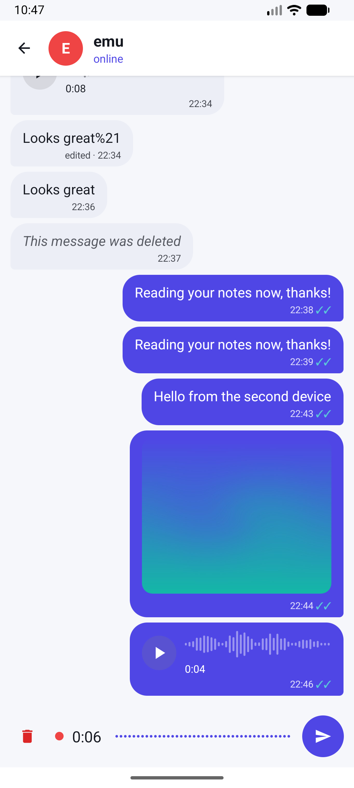
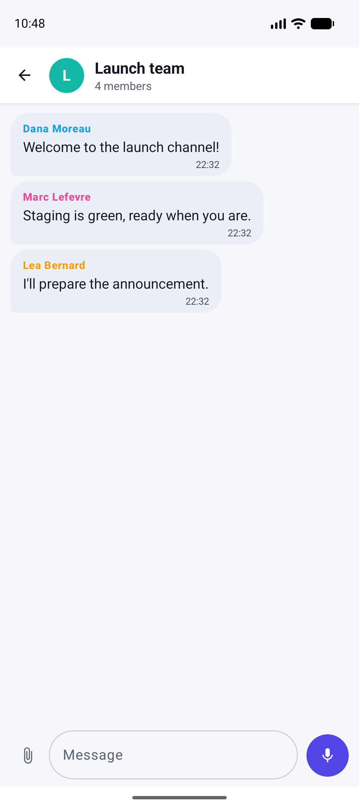
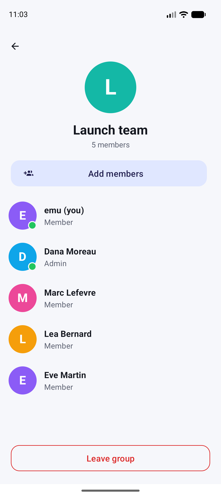
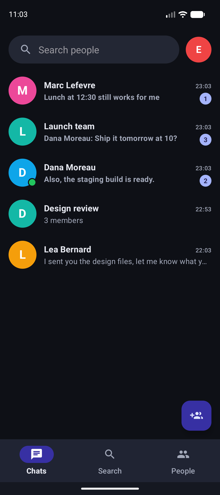
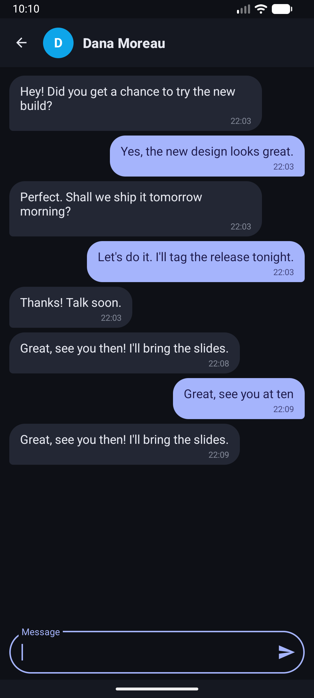

# ChatApp: Android chat with a Node.js server

A real-time messaging app: an **Android client (Java)** talking to a **Node.js server** (Express + Socket.IO) backed by **MySQL**. Sign up, find people, add friends, chat one-to-one or in groups, and send photos, voice messages and files; everything is delivered instantly and stored in the database.

```
Android app (Java, Volley, Socket.IO client, Room cache)
      │  HTTP  :8001  sign up / sign in / search / friends / history / uploads
      │  WebSocket :8000  live messages, typing, presence, read receipts
      ▼
Node.js server (Express, Socket.IO, Argon2) ──► MySQL 8 (users, friends, messages, groups, uploads)
                                          └──► uploads/ (photos, voice messages, files)
```

## Features

- **Accounts**: sign up and sign in; the session is kept on the phone until you log out or it expires. Passwords are stored as Argon2 hashes, and the server issues a signed token (see *Authentication*). A profile picture can be set from the profile screen.
- **Conversations** with people and **groups**, most recent first, with an **unread counter** and a green dot when the person is online.
- **Messages**
  - text, **photos** (shrunk and rotated upright before upload, full-screen viewer), **voice messages** and **files** (any type up to 15 MB, opened with the app of your choice);
  - voice messages are recorded with a **live scrolling waveform** and shown as loudness bars that fill while they play;
  - **replies** (the quoted message is shown in the bubble), **edit** and **delete** (your own messages, for everyone);
  - **read receipts** (✓ sent, ✓✓ read), **"typing…"**, **online / last seen**;
  - history loads in pages of 30 as you scroll up.
- **Groups**: create from your friends; any member can add people later (from the header button or the group info), admins can remove members and rename the group, anyone can leave; the sender's name is shown on each message. When the last admin leaves, another member becomes admin.
- **Offline reading**: the conversation list and the latest messages of each conversation are cached on the phone (Room) and shown instantly, then refreshed from the server.
- **Search** tab: full-text search of users by name or e-mail (results ranked by relevance). **People** tab: add and remove friends.
- Material 3 design with light and dark themes.

## Screenshots

The app running on two Android emulators against the server from this repository.

| Chats (unread, groups) | Conversation (photo, voice) | Recording a voice message |
| :---: | :---: | :---: |
|  |  |  |

| Group chat | Group members | Profile |
| :---: | :---: | :---: |
|  |  |  |

| Sign in | Sign up | Search |
| :---: | :---: | :---: |
|  |  |  |

| Chats (dark) | Conversation (dark) |
| :---: | :---: |
|  |  |

The emulator's microphone is silent, so the recording screenshot shows the flat baseline; on a phone the bars follow your voice.

## Quick start (server and database)

```bash
docker compose up --build        # MySQL 8 with the sample database + the server (ports 8001 and 8000)
# set your own signing secret for the login tokens:  JWT_SECRET=$(openssl rand -hex 32) docker compose up --build
npm install && npm run smoke     # end-to-end checks against the running server
```

The sample database (`chatdb.sql`) contains a few test accounts whose passwords are not documented: create your own account from the app or with `POST /signup`.

The schema added since `chatdb.sql` (attachments, groups, read receipts, profile pictures, waveforms) is created by `server/migrate.js` every time the server starts. It is idempotent, so an existing database is upgraded in place. Uploaded files live in the `uploads` volume (`UPLOAD_DIR`).

### Without Docker

Create a MySQL database named `ChatDB`, import `chatdb.sql` into it (phpMyAdmin or `mysql ChatDB < chatdb.sql`), then:

```bash
npm install
npm run server                   # or: npm start
```

| Variable | Default | |
| --- | --- | --- |
| `DB_HOST` / `DB_PORT` | `localhost` / `3306` | MySQL address |
| `DB_USER` / `DB_PASSWORD` | `root` / empty | MySQL login |
| `DB_NAME` | `ChatDB` | database name |
| `PORT` | `8001` | HTTP API |
| `SOCKET_PORT` | `8000` | Socket.IO |
| `UPLOAD_DIR` | `./uploads` | where uploaded files are stored |
| `JWT_SECRET` | random at each start | secret that signs the login tokens: set a long random value, otherwise every token stops working when the server restarts |
| `TOKEN_LIFETIME` | `30d` | how long a token stays valid (`30d`, `12h`, ...) |

## Android app

The app needs the address of the computer running the server. It is a build-time setting, so there is no source to edit:

```bash
nix develop .#android                                      # JDK 17 + Android SDK 33 (or use Android Studio)
./gradlew assembleDebug                                    # emulator: reaches the host at 10.0.2.2 (the default)
./gradlew assembleDebug -PchatServerHost=192.168.1.20      # real phone: your computer's LAN IP
```

The APK is written to `app/build/outputs/apk/debug/app-debug.apk`. In Android Studio, put `chatServerHost=192.168.1.20` in `~/.gradle/gradle.properties`. The phone and the computer must be on the same network. Plain HTTP is allowed (`usesCleartextTraffic`) because the server is meant for a local network. The app asks for the microphone permission the first time you record.

## Authentication

- `/signup` and `/signin` are public and return a **token** (a signed JWT, HS256, valid `TOKEN_LIFETIME`).
- Every other route needs `Authorization: Bearer <token>`; without a valid one the answer is `401`. The Android app stores the token with the session and sends it on every request; if the server answers `401` the app signs the user out.
- The identity always comes from the token, never from an id in the request. You can only read your own friends and conversations, send messages as yourself, edit or delete your own messages, read a conversation you take part in, and download files from conversations you belong to (`403` / `404` otherwise).
- Sign-in gives the same answer for an unknown e-mail and a wrong password, and is limited to 10 failed attempts per address and e-mail every 15 minutes (`429`).
- Sign-up checks lengths against the database columns (name 1-20, e-mail 1-50) and requires a password of at least 6 characters.
- Socket.IO connections are authenticated too (below).
- **Uploads**: a file is uploaded first and then attached to a message by the random name the server returns. Only its uploader can attach it, and only once; the type must match (an image message needs a JPEG, PNG, WebP or GIF). Files are served with `nosniff`, a sandboxing `Content-Security-Policy` and `Content-Disposition: attachment` (except images and audio), so an uploaded HTML file can never run as a page.

The app talks plain HTTP on the local network; put the server behind HTTPS before exposing it beyond that, because tokens and passwords travel in clear otherwise.

## HTTP API

Routes are `POST` with a JSON body (or form body) and answer with JSON; a failure is `{"error": "..."}`. Message objects look like `{messageID, sender, receiver, groupID, type, content, attachment, fileName, fileSize, duration, waveform, replyTo, reply, edited, deleted, readAt, date, senderName}`.

| Route | Body | Returns |
| --- | --- | --- |
| `/signup` | `userName`, `userEmail`, `userPassword` | `userID`, `token` |
| `/signin` | `userEmail`, `userPassword` | `userID`, `userName`, `userEmail`, `avatar`, `token` |
| `/user` | `userID` | `userID`, `userName`, `userEmail`, `avatar`, `online`, `lastSeen` |
| `/search` | `searchTable` (`users`), `searchCols` (`userName, userEmail`), `searchTerm` | `results` (up to 100 users) |
| `/friends` | `userID` | `friends` |
| `/friends/add`, `/friends/remove` | `userID1`, `userID2` | the database result (`affectedRows` is `1` on success) |
| `/conversations` | | `conversations`: people and groups, most recent first, with `preview`, `unread`, `online` |
| `/messages` | `userID1`, `userID2`, optional `limit` (30, max 100) and `before` (a `messageID`) | `messages` (oldest first), `hasMore` |
| `/messages/send` | `receiver` or `groupID`; `type` (`text`, `image`, `audio`, `file`); `content`; `attachment`; `duration`, `waveform` (voice); `replyTo` | `messageID`, `message` |
| `/messages/edit`, `/messages/delete` | `messageID` (+ `content`) | `message` |
| `/messages/read` | `userID` or `groupID` | how many messages were marked read |
| `/upload?name=<file name>` | the file as the raw body, with its `Content-Type` (15 MB max) | `attachment` |
| `GET /files/<attachment>` | | the file (if you belong to the conversation it was sent in) |
| `/me/avatar` | `attachment` (an uploaded image) or `null` | `avatar` |
| `/groups/create` | `name`, `members` (user ids) | `groupID` |
| `/groups/info`, `/groups/messages` | `groupID` (+ paging for messages) | `group` with members and roles / `messages` |
| `/groups/rename`, `/groups/add`, `/groups/remove` | `groupID` + `name` / `userID` | any member can add; only admins rename or remove others; anyone may remove themselves to leave |

## Real time (Socket.IO)

1. The client connects with its token in the handshake (`auth: {token}`; `?token=` also works). Without a valid token the connection is refused with `authentication required`.
2. Messages can be sent over the socket (`chat message`, a JSON string with the same fields as `/messages/send`) or with `/messages/send`; the server saves the message, then emits it as `chat message` to every connected device of the sender and the receiver (or of every group member).
3. Other events from the server: `message updated` (edit / delete), `messages read` (`{by, ids}`), `typing` (`{from, groupID, typing}`), `presence` (`{userID, online, lastSeen}`, sent to friends, people you talk to and group mates), `group updated` (`{groupID, removed}`).
4. From the client: `typing` (`{to}` or `{groupID}`, `typing: true | false`).

Malformed or incomplete payloads are ignored.

## Tests

```bash
npm run smoke                  # about 160 end-to-end checks: API, authentication, authorization, SQL injection,
                               # uploads, groups, receipts, paging, typing, presence, real time
./gradlew testDebugUnitTest    # the app's own unit tests (messages, waveforms, formatting, media helpers)
```

The smoke test needs the server running (`docker compose up --build`). The same two commands run in GitHub Actions (`.github/workflows/ci.yml`): the server against a MySQL service container, and the Android build.

## Project layout

```
app/                    Android app (package com.example.chatapp)
  Api, ChatEvents       server calls (JSON, token) and the real-time events fanned out to the open screens
  ChatFragment          the conversation screen (an Activity despite the name)
  Media, Attachments    downloading, caching and preparing photos, voice messages and files
  Cache*                Room cache for offline reading
server.js               Express API, sign in, Socket.IO, presence and typing
server/                 messaging.js, groups.js, uploads.js, migrate.js (schema changes applied at start)
chatdb.sql              original schema and sample data
scripts/smoke-test.js   end-to-end test of the whole server
docker-compose.yml      MySQL + server;  Dockerfile builds the server image
flake.nix               Nix dev shells (server, Android SDK)
```

## Tech stack

Android (Java, Volley, Material 3, Navigation, Room, `socket.io-client`) · Node.js 22 · Express 4 · Socket.IO 4 · MySQL 8 (`mysql2`, full-text search) · Argon2 · Docker Compose · GitHub Actions · Gradle 7.5 / Android Gradle Plugin 7.4.

## Not done (yet)

- Push notifications (needs a Firebase project): you only see new messages while the app is open.
- End-to-end encryption and HTTPS: messages and files are stored in clear on the server.
- Unsent messages are not queued while offline (reading offline works, sending does not).
