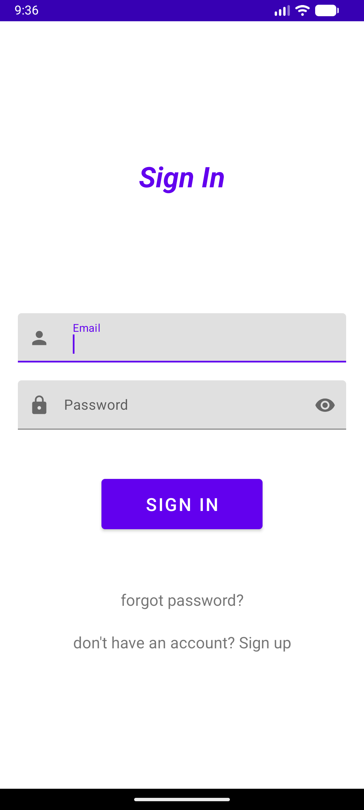
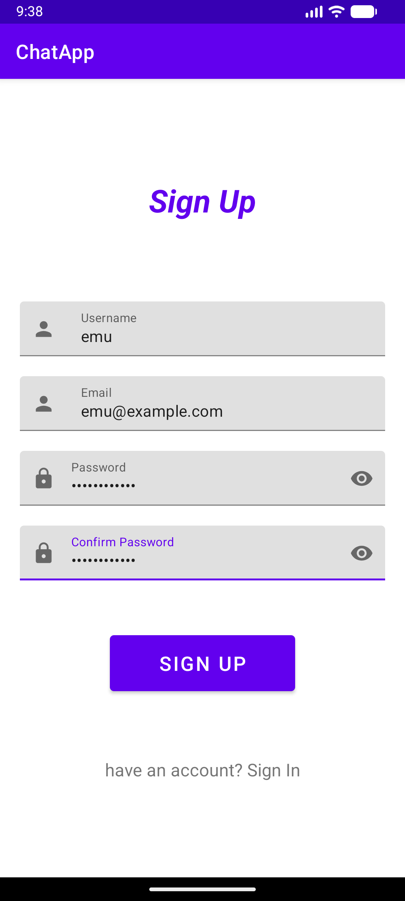
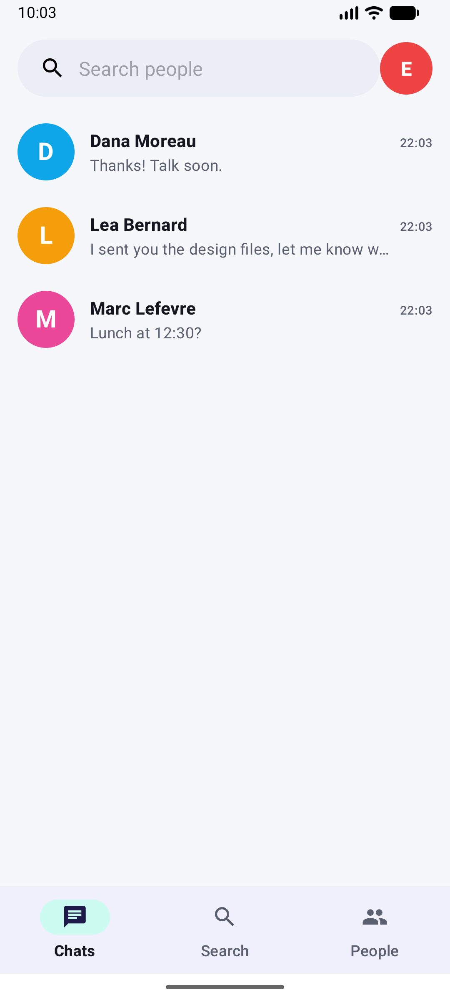
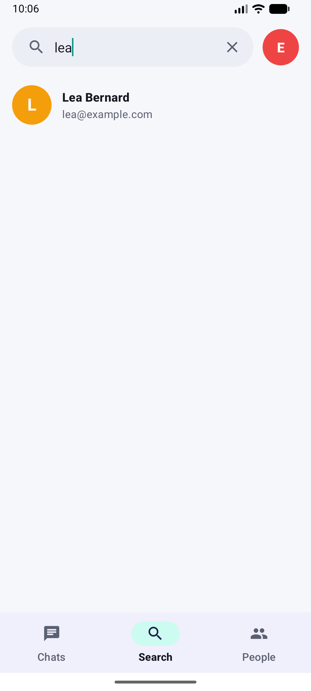
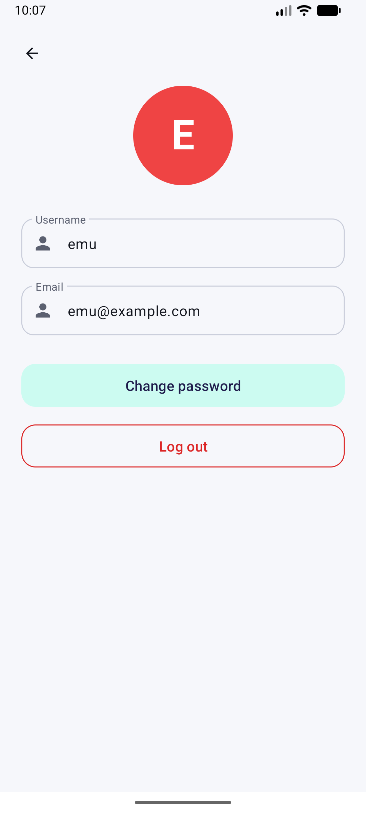
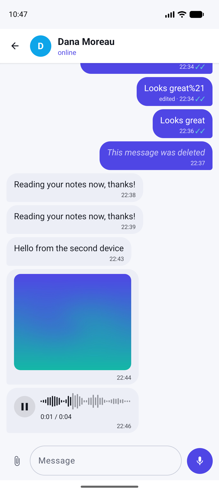

# ChatApp: Android chat with a Node.js server

A real-time messaging app: an **Android client (Java)** talking to a **Node.js server** (Express + Socket.IO) backed by **MySQL**. Sign up, find people, add friends and chat; messages are delivered instantly and stored in the database.

```
Android app (Java, Volley, Socket.IO client)
      │  HTTP  :8001  sign up / sign in / search / friends / history
      │  WebSocket :8000  live messages
      ▼
Node.js server (Express, Socket.IO, Argon2) ──► MySQL 8 (users, friends, messages)
```

## Features

- Sign up and sign in; the session is kept on the phone until you log out or it expires. Passwords are stored as Argon2 hashes, and the server issues a signed token (see *Authentication*).
- **Chats** tab with the list of conversations and the conversation view with live delivery over Socket.IO.
- **Search** tab: full-text search of users by name or e-mail (results ranked by relevance).
- **People** tab: add and remove friends.
- Account screen with your profile and log out.

## Screenshots

The app running on an Android emulator against the server from this repository.

| Sign in | Sign up | Chats |
| :---: | :---: | :---: |
|  |  |  |

| Search | Profile | Conversation |
| :---: | :---: | :---: |
|  |  |  |

## Quick start (server and database)

```bash
docker compose up --build        # MySQL 8 with the sample database + the server (ports 8001 and 8000)
# set your own signing secret for the login tokens:  JWT_SECRET=$(openssl rand -hex 32) docker compose up --build
npm install && npm run smoke     # 56 end-to-end checks against the running server
```

The sample database (`chatdb.sql`) contains a few test accounts whose passwords are not documented: create your own account from the app or with `POST /signup`.

### Without Docker

Create a MySQL database named `ChatDB`, import `chatdb.sql` into it (phpMyAdmin or `mysql ChatDB < chatdb.sql`), then:

```bash
npm install
npm run server                   # or: npm start
```

| Variable | Default | |
| --- | --- | --- |
| `DB_HOST` / `DB_PORT` | `localhost` / `3306` | MySQL address |
| `DB_USER` / `DB_PASSWORD` | `root` / empty | MySQL login |
| `DB_NAME` | `ChatDB` | database name |
| `PORT` | `8001` | HTTP API |
| `SOCKET_PORT` | `8000` | Socket.IO |
| `JWT_SECRET` | random at each start | secret that signs the login tokens: set a long random value, otherwise every token stops working when the server restarts |
| `TOKEN_LIFETIME` | `30d` | how long a token stays valid (`30d`, `12h`, ...) |

## Android app

The app needs the address of the computer running the server. It is a build-time setting, so there is no source to edit:

```bash
nix develop .#android                                      # JDK 17 + Android SDK 33 (or use Android Studio)
./gradlew assembleDebug                                    # emulator: reaches the host at 10.0.2.2 (the default)
./gradlew assembleDebug -PchatServerHost=192.168.1.20      # real phone: your computer's LAN IP
```

The APK is written to `app/build/outputs/apk/debug/app-debug.apk`. In Android Studio, put `chatServerHost=192.168.1.20` in `~/.gradle/gradle.properties`. The phone and the computer must be on the same network. Plain HTTP is allowed (`usesCleartextTraffic`) because the server is meant for a local network.

## Authentication

- `/signup` and `/signin` are public and return a **token** (a signed JWT, HS256, valid `TOKEN_LIFETIME`).
- Every other route needs `Authorization: Bearer <token>`; without a valid one the answer is `401`. The Android app stores the token with the session and sends it on every request; if the server answers `401` the app signs the user out.
- The identity always comes from the token, never from an id in the request. You can only read your own friends and chat list, send messages as yourself, add or remove your own friendships, and read a conversation you take part in (`403` otherwise).
- Sign-in gives the same answer for an unknown e-mail and a wrong password, and is limited to 10 failed attempts per address and e-mail every 15 minutes (`429`).
- Sign-up checks lengths against the database columns (name 1-20, e-mail 1-50) and requires a password of at least 6 characters.
- Socket.IO connections are authenticated too (below).

The app talks plain HTTP on the local network; put the server behind HTTPS before exposing it beyond that, because tokens and passwords travel in clear otherwise.

## HTTP API

All routes are `POST` with a JSON or form body and answer with JSON; a failure is `{"error": "..."}`.

| Route | Body | Returns |
| --- | --- | --- |
| `/signup` | `userName`, `userEmail`, `userPassword` | `userID`, `token` |
| `/signin` | `userEmail`, `userPassword` | `userID`, `userName`, `userEmail`, `token` |
| `/user` | `userID` | `userID`, `userName`, `userEmail` |
| `/search` | `searchTable` (`users`), `searchCols` (`userName, userEmail`), `searchTerm` | `results` (up to 100 users) |
| `/friends` | `userID` | `friends` |
| `/friends/add`, `/friends/remove` | `userID1`, `userID2` | `messages`: the database result (`affectedRows` is `1` on success) |
| `/chats` | `userID` | `messages`: the user's messages, each with the name and e-mail of the person involved (the app turns them into the conversation list) |
| `/messages` | `userID1`, `userID2` | `messages`: the conversation |
| `/messages/send` | `sender`, `receiver`, `content` | `messageID` (the server stamps the time) |

## Tests

```bash
npm run smoke                                          # 56 checks: API, authentication, authorization, SQL injection, real time
CHAT_SERVER_HOST=localhost ./gradlew testDebugUnitTest # the app's own Socket.IO client against the server's token check
```

Both need the server running (`docker compose up --build`); the Gradle test is skipped when `CHAT_SERVER_HOST` is not set.

## Real time (Socket.IO)

1. The client connects with its token in the handshake (`auth: {token}`; `?token=` also works). Without a valid token the connection is refused with `authentication required`.
2. On connection the server emits `init request`; the client answers `init` (the user is the one named by the token; an id sent by the client is ignored).
3. To send, the client emits `chat message` with a JSON string `{"sender", "receiver", "content"}` (a `date` is accepted but ignored: the server stamps the time). `sender` must be the authenticated user, otherwise the message is dropped.
4. The server forwards it to the sender's and the receiver's connected devices as `chat message` and saves it.

Malformed or incomplete payloads are ignored.

## Project layout

```
app/                    Android app (package com.example.chatapp): activities, fragments, adapters
server.js               Express API + Socket.IO server
chatdb.sql              database schema and sample data
scripts/smoke-test.js   end-to-end test of the API, the authorization rules and the real-time path
docker-compose.yml      MySQL + server;  Dockerfile builds the server image
flake.nix               Nix dev shells (server, Android SDK)
```

## Tech stack

Android (Java, Volley, Material, Navigation, `socket.io-client`) · Node.js 22 · Express 4 · Socket.IO 4 · MySQL 8 (`mysql2`, full-text search) · Argon2 · Docker Compose · Gradle 7.5 / Android Gradle Plugin 7.4.
